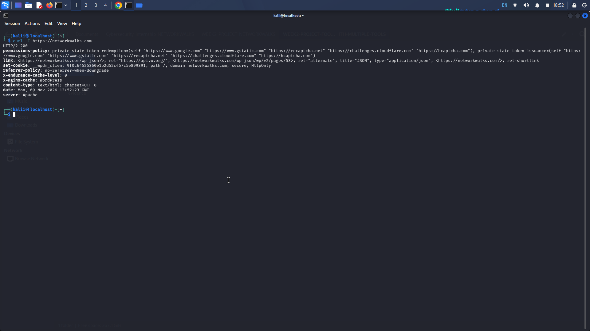
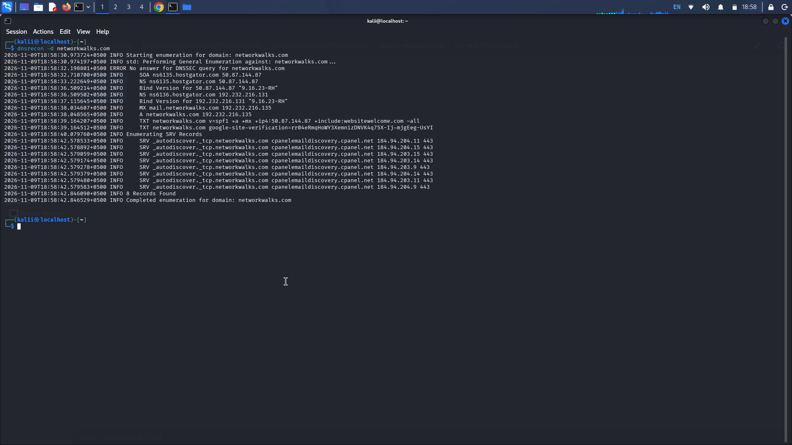
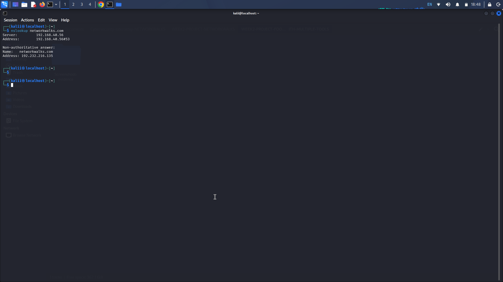
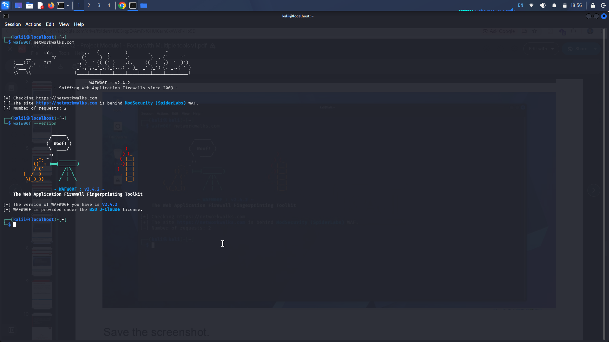
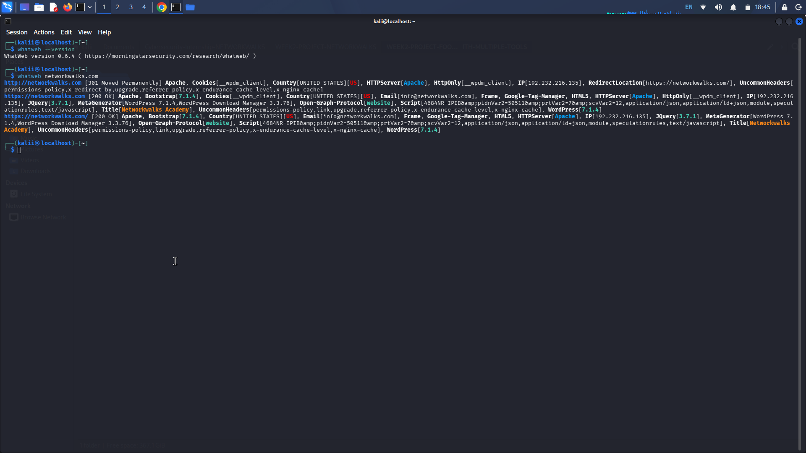
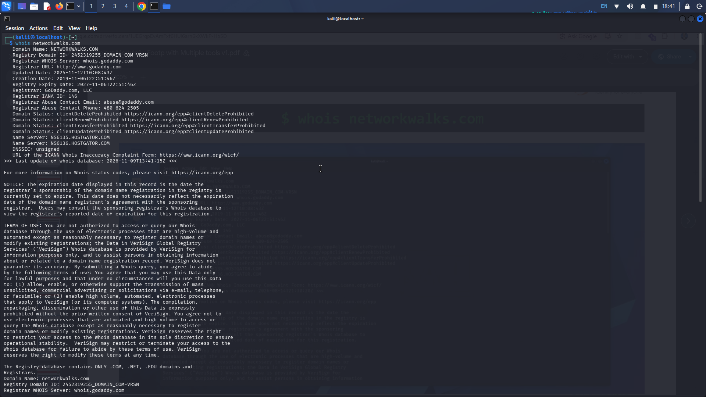

# PENETRATION TESTING REPORT

### Footprinting & Reconnaissance Phase

**W2-PM1 | CYBERSECURITY | NETWORKWALKS**

| **Field** | **Detail** |
|---|---|
| **Pentester Name (Cybersecurity Intern)** | **Hamza Riaz** |
| **Program / Batch** | **B084** |
| **Date** | 09 November 2026 |
| **Module Completed** | W2-PM1 – Footprinting & Reconnaissance Attacks with Multiple Kali Tools |
| **Client / Target** | NetworkWalks – `networkwalks.com` (assigned training target) |
| **Testing Environment** | Kali Linux |
| **Primary Tools** | WHOIS, WhatWeb, Nslookup, cURL, WAFW00F, DNSRecon |
| **Phase Covered** | **Phase 1:** Reconnaissance & Footprinting |
| **Report Status** | Practical Activities Completed |

---

# 1. Liability Disclaimer

I performed these activities as part of my cybersecurity and ethical hacking training at NetworkWalks.

The assessment was limited to the assigned educational exercise and publicly accessible information. No exploitation, unauthorized access, or intentional disruption of the target system was performed.

All information in this report is intended for educational and research purposes only. Any further security testing must be conducted within an explicitly authorized scope.

The tester, instructor, and training organization should not be held responsible for unauthorized use or misuse of the techniques described in this report. All cybersecurity activities must comply with applicable laws and authorization requirements.

Sensitive technical information, including the target's actual IP address, has intentionally been excluded from this public report.

# 2. Introduction

This report documents the practical activities completed during Week 2, Project Module 1 (W2-PM1), as part of my Cybersecurity Internship at NetworkWalks.

The project focused on **Footprinting and Reconnaissance**, which is an important initial phase of penetration testing. The purpose was to understand how security professionals collect and analyze publicly available information about a target domain before conducting further security assessments.

I used six different Kali Linux tools to examine various aspects of the assigned target, including domain registration information, website technologies, DNS resolution, HTTP response headers, Web Application Firewall detection, and DNS records.

Each tool provided a different perspective on the target's publicly exposed infrastructure.

This report explains the activities performed, commands used, observations made, potential security implications, and recommendations based on the practical assessment.

# 3. Tools Used

The following tools were used during the practical assessment.

| **Tool** | **Purpose** |
|---|---|
| Kali Linux | Operating system and cybersecurity testing environment. |
| WHOIS | Retrieve publicly available domain registration information. |
| WhatWeb | Identify website technologies, CMS, frameworks, and software components. |
| Nslookup | Resolve domain names through DNS queries. |
| cURL | Inspect HTTP response headers and server responses. |
| WAFW00F | Detect the presence and identify the type of Web Application Firewall. |
| DNSRecon | Enumerate DNS records, including NS, MX, SPF, TXT, and SRV records. |

# 4. Activities Performed

## 4.1 Footprinting & Reconnaissance

I performed footprinting and reconnaissance against the assigned `networkwalks.com` domain using six Kali Linux tools.

Each tool was used to collect a specific category of publicly available technical information.

### Task 01 – WHOIS Domain Information Gathering

**Objective:**

Retrieve publicly available domain registration information, including registrar details, registration dates, and name servers.

**Command Executed:**

```bash
whois networkwalks.com
```

**Activity Performed:**

I used WHOIS to query the public domain registration database. The output provided information about the domain's registration and associated name servers.

**Observation:**

The results provided domain registration information and identified the associated name server infrastructure.

**Security Relevance:**

Domain registration information can help security professionals understand domain ownership, hosting arrangements, and publicly exposed infrastructure details.

**Evidence:**

`[tool-whois-perform.png]`

### Task 02 – WhatWeb Website Technology Fingerprinting

**Objective:**

Identify technologies and software components used by the target website.

**Command Executed:**

```bash
whatweb networkwalks.com
```

**Activity Performed:**

I used WhatWeb to fingerprint the target website and identify detectable technologies, including its content management system, plugins, and web-related components.

**Observation:**

The practical output identified WordPress and WP Download Manager, along with additional website technology information.

**Security Relevance:**

Technology fingerprinting helps security professionals understand the software environment and identify components that may require security updates or further assessment.

**Evidence:**

`[tool-whatweb-perform.png]`

### Task 03 – Nslookup DNS Resolution

**Objective:**

Resolve the target domain name and examine its DNS resolution information.

**Command Executed:**

```bash
nslookup networkwalks.com
```

**Activity Performed:**

I used Nslookup to perform a DNS query and retrieve the corresponding domain resolution information.

**Observation:**

The command successfully returned DNS resolution information for the target domain.

**Security Relevance:**

DNS resolution helps security professionals understand how domain names are associated with network infrastructure and supports further reconnaissance activities.

**Evidence:**

`[tool-nslookup-perform.png]`

### Task 04 – cURL HTTP Response Header Analysis

**Objective:**

Inspect HTTP response headers to identify server-related information and other exposed web configuration details.

**Command Executed:**

```bash
curl -I https://networkwalks.com
```

**Activity Performed:**

I used cURL with the `-I` option to retrieve the HTTP response headers without downloading the complete webpage.

**Observation:**

The response provided HTTP header information and exposed the presence of the WordPress REST API endpoint.

**Security Relevance:**

HTTP response headers can reveal technical information about web servers, application technologies, caching mechanisms, and exposed application endpoints.

**Evidence:**

`[tool-curl-perform.png]`

### Task 05 – WAFW00F Web Application Firewall Detection

**Objective:**

Determine whether a Web Application Firewall was protecting the target website.

**Command Executed:**

```bash
wafw00f networkwalks.com
```

**Activity Performed:**

I used WAFW00F to analyze the target website's responses and identify whether a Web Application Firewall was present.

**Observation:**

The practical output identified ModSecurity (SpiderLabs) as the detected Web Application Firewall technology.

**Security Relevance:**

Identifying a WAF helps security professionals understand the web application's defensive infrastructure and the security controls protecting it.

**Evidence:**

`[tool-WAF-perform.png]`

### Task 06 – DNSRecon DNS Enumeration

**Objective:**

Enumerate publicly available DNS records associated with the target domain.

**Command Executed:**

```bash
dnsrecon -d networkwalks.com
```

**Activity Performed:**

I used DNSRecon to enumerate DNS information and examine the target domain's DNS infrastructure.

The assessment included:

- Name Server (NS) records.
- Mail Exchange (MX) records.
- SPF information.
- TXT records.
- Service (SRV) records.
- Other available DNS information.

**Observation:**

The practical output provided information about the domain's DNS infrastructure, mail services, SPF policy, and service-related records.

**Security Relevance:**

DNS enumeration helps security professionals understand an organization's publicly exposed DNS infrastructure and identify information that may be relevant to further security assessments.

**Evidence:**

`[tool-dns-recon-perform.png]`

## 4.2 Summary of Activities

The following table summarizes all six activities completed during this module.

| **No.** | **Activity** | **Tool Used** | **Status** |
|---|---|---|---|
| 01 | Domain Registration Information | WHOIS | Completed |
| 02 | Website Technology Fingerprinting | WhatWeb | Completed |
| 03 | DNS Resolution | Nslookup | Completed |
| 04 | HTTP Header Analysis | cURL | Completed |
| 05 | Web Application Firewall Detection | WAFW00F | Completed |
| 06 | DNS Enumeration | DNSRecon | Completed |

# 5. Risk Analysis / Impact

Based on the observations collected during the footprinting and reconnaissance activities, the following potential security considerations were identified.

| **#** | **Risk / Finding** | **Evidence / Observation** | **Potential Impact** | **Risk Level** |
|---|---|---|---|---|
| 1 | Domain registration information exposed | WHOIS returned public registration and name server information. | Helps build a profile of domain ownership and infrastructure. | Low |
| 2 | Website technology information exposed | WhatWeb identified WordPress and WP Download Manager. | Technology information may help identify components requiring security review. | Medium |
| 3 | DNS resolution information available | Nslookup successfully resolved the target domain. | Provides infrastructure information useful for reconnaissance. | Low |
| 4 | HTTP technical information exposed | cURL returned HTTP headers and WordPress REST API information. | May assist application fingerprinting and endpoint discovery. | Low |
| 5 | WAF technology identifiable | WAFW00F detected ModSecurity (SpiderLabs). | Reveals information about the application's defensive architecture. | Informational |
| 6 | DNS infrastructure information exposed | DNSRecon returned DNS, mail, and service-related information. | Helps build a broader picture of the domain's infrastructure. | Low |

**Risk Classification:**

- **Critical:** A severe, validated security issue requiring immediate attention.
- **High:** A significant, validated security weakness.
- **Medium:** A potential security concern requiring further investigation.
- **Low:** Limited security exposure or information disclosure.
- **Informational:** An observation that does not independently establish a vulnerability.

**Important Assessment Note:**

The risk levels above are preliminary classifications of information exposure, not confirmed vulnerabilities.

Identifying a software version, DNS record, HTTP header, or WAF does not automatically mean the target is vulnerable.

No exploitation or vulnerability validation was performed during this module. Further authorized assessment would be necessary to establish whether any actual security weakness exists.

# 6. Recommendations

Based on the observations from the footprinting and reconnaissance activities, the following security recommendations are suggested:

1. **Review Public Domain Information**

   Organizations should periodically review publicly available domain registration information and ensure that unnecessary sensitive details are not exposed.

2. **Maintain Updated Website Technologies**

   CMS platforms, plugins, and web components should be regularly updated to address known security issues.

3. **Review DNS Configuration**

   DNS records should be reviewed periodically to ensure that only required records and services are publicly accessible.

4. **Inspect HTTP Response Headers**

   Web administrators should review HTTP headers and avoid unnecessarily exposing technical information about their infrastructure.

5. **Maintain Web Application Firewall Protection**

   WAF configurations should be regularly reviewed, updated, and monitored to support effective web application protection.

6. **Monitor Publicly Exposed Services**

   Organizations should regularly assess their publicly exposed services and investigate unnecessary service exposure.

7. **Perform Regular Security Assessments**

   Authorized reconnaissance and security assessments should be conducted periodically to identify changes in the organization's external attack surface.

# 7. Conclusion

During Week 2 of my Cybersecurity Internship at NetworkWalks, I successfully completed Project Module 1, focusing on Footprinting and Reconnaissance using multiple Kali Linux tools.

I performed six practical activities using WHOIS, WhatWeb, Nslookup, cURL, WAFW00F, and DNSRecon.

Through these activities, I gained practical experience in domain information gathering, website technology fingerprinting, DNS resolution, HTTP response header analysis, Web Application Firewall detection, and DNS enumeration.

This project helped me understand how security professionals collect and analyze publicly available information to build an initial understanding of a target's infrastructure before conducting further security assessments.

I also learned the importance of documenting technical observations, identifying potential security implications, and maintaining ethical boundaries throughout the testing process.

Overall, this project strengthened my practical understanding of reconnaissance techniques and provided a foundation for the next stages of penetration testing and network security.

# 8. Evidences Collected

The following screenshots will be attached as evidence of the practical activities performed during this project.

All evidence will be reviewed before publication to ensure that sensitive information, particularly actual IP addresses, is not exposed.














---

# TESTER INFORMATION

| **Field** | **Details** |
|---|---|
| **Tester Name** | Hamza Riaz (Intern) |
| **Batch** | B084 |
| **Training Organization** | NetworkWalks |
| **Environment** | Kali Linux |
| **Project Module** | W2-PM1 |
| **Project Title** | Footprinting & Reconnaissance Attacks with Multiple Kali Tools |
| **Primary Category** | Cybersecurity & Ethical Hacking |

---

<p align="center">

**END OF PENETRATION TESTING REPORT**

**HAMZA RIAZ | CYBERSECURITY INTERN**

*Learning • Practicing • Securing*

**NETWORKWALKS**

</p>
